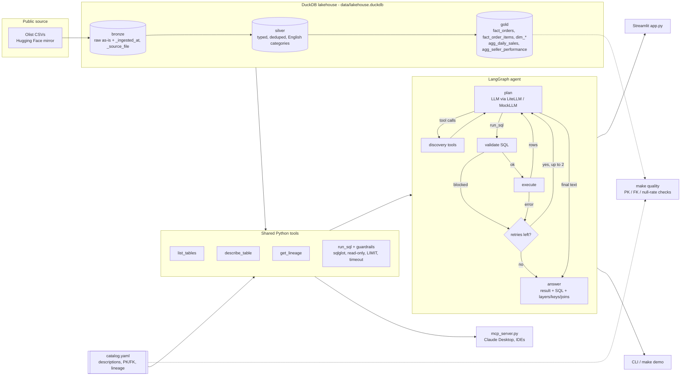

# Lakehouse SQL Agent

**Ask a data lake questions in plain English. Get the answer, the SQL behind it, and which bronze/silver/gold tables, keys and joins were used.**

A data-discovery and text-to-SQL agent over a medallion (bronze → silver → gold) lakehouse built from the public Olist Brazilian e-commerce dataset. It explains schemas, primary/foreign keys and lineage, writes guarded read-only SQL, corrects its own errors, and serves the same tools to any MCP client (for example Claude Desktop).

  
<!-- Replace with your CI badge: https://github.com/saranyabalantrapu123-cmd/lakehouse-sql-agent -->

---

## Why this matters

In most data organizations, analysts and business partners can't find the right table, don't know whether `orders` in one layer equals `orders` in another, and don't know which key joins two tables. So they file a ticket with data engineering. Those "where is X / how do I join Y / is this number right" requests use up engineering time and slow down every decision that needs data.

This agent puts that knowledge where people can use it themselves:

- **Self-serve data discovery.** "What tables are in gold?", "What's the primary key of fact_order_items?", "Where does agg_daily_sales come from?" are answered straight from a governed catalog.
- **Fewer requests to data engineering.** Routine metric questions come back with the SQL attached, so analysts can reuse it, check it, or hand it off. They don't have to wait in a queue.
- **Trust by default.** Every answer shows the layer, tables, keys and joins it used. Guardrails make the agent read-only, and data-quality checks run against the same catalog.
- **One toolset, many front doors.** The same Python tools power the LangGraph agent, a Streamlit chat app, and an MCP server, so the catalog can be used from Claude Desktop or an IDE.

## Demo


> Add your recording here (`docs/demo.gif`). Suggested flow: list gold tables → keys of `fact_order_items` → lineage of `agg_seller_performance` → "top 5 categories by revenue" with the SQL expander open.

## Architecture



## Quickstart

**Offline demo (no API key, about 1 minute):**

```bash
make setup          # pip install -r requirements.txt
make data build     # download ~65 MB of public CSVs, build bronze/silver/gold
make demo           # 6 sample questions answered end-to-end in offline mode
```

Then `make app` for the chat UI, `make quality` for the data-quality report, and `make test` for the offline test suite. The tests don't need the download.

**With a real LLM:**

```bash
cp .env.example .env            # set ANTHROPIC_API_KEY (default model: anthropic/claude-sonnet-4-5)
export $(grep -v '^#' .env | xargs)
make ask Q="Which 5 sellers have the highest late-delivery rate with at least 100 orders?"
make eval                        # execution accuracy, tool calls, latency, tokens, cost
```

Any LiteLLM model works (`LLM_MODEL=openai/gpt-4o` with `OPENAI_API_KEY`, and so on). With no key, or with `LLM_MODEL=mock`, everything runs in **offline demo mode** with a clear banner.

**Docker:** `docker build -t lakehouse-sql-agent . && docker run -p 8501:8501 -e ANTHROPIC_API_KEY lakehouse-sql-agent`

### Use it from Claude Desktop (MCP)

Build the lakehouse first (`make data build`), then add this to `claude_desktop_config.json` (macOS: `~/Library/Application Support/Claude/`, Windows: `%APPDATA%\Claude\`):

```json
{
  "mcpServers": {
    "lakehouse": {
      "command": "python3",
      "args": ["/absolute/path/to/lakehouse-sql-agent/mcp_server.py"]
    }
  }
}
```

Restart Claude Desktop. It can then call `list_tables`, `describe_table`, `get_lineage` and `run_sql` with the same guardrails. For Claude Code: `claude mcp add lakehouse -- python3 /absolute/path/to/lakehouse-sql-agent/mcp_server.py`.

## How it works

### Medallion lakehouse (`lakehouse_agent/build_lakehouse.py`)

| Layer | What happens | Tables |
|---|---|---|
| **bronze** | CSVs loaded as-is (all `VARCHAR`), plus `_ingested_at` and `_source_file` audit columns | `customers, orders, order_items, order_payments, order_reviews, products, sellers, category_translation` |
| **silver** | trim and cast types, deduplicate on the business key, standardize names (fixes source typos such as `product_name_lenght`), translate categories to English (adds the 2 missing translations) | `customers, orders, order_items, order_payments, order_reviews, products, sellers, product_categories` |
| **gold** | star schema and marts; revenue excludes freight and canceled/unavailable orders | `fact_orders, fact_order_items, dim_customers, dim_products, dim_sellers, agg_daily_sales, agg_seller_performance` |

Row counts from the full public dataset (written to `data/build_manifest.json` on every build):

| Table | Rows | Table | Rows | Table | Rows |
|---|---:|---|---:|---|---:|
| bronze.customers | 99,441 | silver.customers | 99,441 | gold.dim_customers | 99,441 |
| bronze.orders | 99,441 | silver.orders | 99,441 | gold.fact_orders | 99,441 |
| bronze.order_items | 112,650 | silver.order_items | 112,650 | gold.fact_order_items | 112,650 |
| bronze.order_payments | 103,886 | silver.order_payments | 103,886 | gold.dim_products | 32,951 |
| bronze.order_reviews | 99,224 | silver.order_reviews | 99,224 | gold.dim_sellers | 3,095 |
| bronze.products | 32,951 | silver.products | 32,951 | gold.agg_daily_sales | 614 |
| bronze.sellers | 3,095 | silver.sellers | 3,095 | gold.agg_seller_performance | 3,053 |
| bronze.category_translation | 71 | silver.product_categories | 73 | | |

### Catalog and data quality (`catalog.yaml`, `make quality`)

`catalog.yaml` documents every table and column, its layer, primary key, foreign keys and upstream lineage. Downstream lineage is derived from it. A test fails if the catalog and the built database drift apart. `make quality` runs **78 checks** from the same file: PK uniqueness, PK/not-null, FK integrity, and null-rate thresholds. It also prints null rates per column and exits non-zero on any failure. On the real data the result is 77 pass, 1 warn, 0 fail. The warning is real and expected: 610 products have no category in the source, are labeled `unknown`, and so have no match in the category dictionary.

### Agent tools (`lakehouse_agent/tools.py`), shared by the agent, the UI and the MCP server

| Tool | Returns |
|---|---|
| `list_tables(layer?)` | tables with description, row count, primary key |
| `describe_table(name)` | columns (type + description), PK, FKs, tables that reference it, upstream/downstream, sample rows |
| `get_lineage(name)` | direct and transitive upstream/downstream, raw source files, edge list |
| `run_sql(sql)` | guarded execution: columns, rows, tables and layers touched, timing |

### SQL guardrails (`lakehouse_agent/guardrails.py`)

1. Parsed with **sqlglot** (DuckDB dialect). Exactly one statement, and the root must be `SELECT` / `WITH … SELECT` / set operation.
2. Any DDL/DML/admin node is rejected anywhere in the tree (`INSERT`, `UPDATE`, `DELETE`, `DROP`, `CREATE`, `ATTACH`, `COPY`, `PRAGMA`, `SET`, `INSTALL`, …).
3. File, network and system functions are blocked (`read_csv*`, `read_parquet`, `glob`, `getenv`, `duckdb_*`, …), as are table functions in `FROM` and `'file.csv'` replacement scans.
4. Only catalog tables are allowed. Bare names are qualified to their layer, and ambiguous names (`orders`) are rejected with suggestions.
5. An outer `LIMIT 200` is added or tightened.
6. Execution runs on a **read-only** DuckDB connection with `enable_external_access=false` and a **timeout** (`conn.interrupt()`).

### Agent loop (`lakehouse_agent/agent.py`)

The LangGraph state machine works like this: **plan** (LLM with tool schemas via LiteLLM) → **tools** (discovery calls) → **validate** (guardrails) → **execute**. A blocked or failing query goes back to the LLM with the error message so it can **self-correct, up to 2 retries**. After that the agent gives up honestly instead of guessing. The final answer has the result table, the executed SQL, the model's plain-English summary, and a deterministic **"How"** line that lists the layer, the tables with their PKs, and each join classified against catalog keys (`foreign key -> primary key` vs `ad-hoc join`). Token usage and cost are tracked for each question when a real model is used.

**Offline demo mode.** `MockLLM` wraps a rule-based router (`mock_router.py`) that uses the same tool-calling protocol. It handles list/describe/lineage questions and 16 keyword-matched analytic patterns. Anything else gets: *"Offline demo mode can't answer this question … set ANTHROPIC_API_KEY"*. It never makes up an answer.

## Evaluation

`evals/questions.yaml` holds **20 business questions with hand-written gold SQL**. All 20 run on the real built data (`python -m evals.run_eval --check-gold`). `make eval` runs the agent on each question and scores **execution accuracy**: the result sets must match regardless of row order, with 0.5% relative / 0.01 absolute numeric tolerance, and extra agent columns are allowed. It also reports average tool calls, latency, tokens and cost.

| Mode | Execution accuracy | Avg tool calls | Avg latency | Tokens / cost |
|---|---|---|---|---|
| Real LLM (`anthropic/claude-sonnet-4-5`) | *run `make eval` with your key to fill in* | – | – | – |
| Offline mock router | 16/20 (80%) | 1.6 | ~0.05 s | 0 / $0 |

> **Read the mock row carefully.** The mock router's templates were hand-written by the same author as the eval questions. Its score only shows that routing → guardrails → execution → scoring works end-to-end. It is **not** a measure of LLM quality. The 4 questions it has no pattern for are reported as skipped, not guessed.

Tests (`make test`, 67 tests, offline, a few seconds) build a tiny fixture lakehouse from `tests/fixtures/` and cover the build (dedupe, typing, translation, measures), catalog and database consistency, quality checks, 25 blocked-SQL cases (DROP, INSERT, ATTACH, read_csv, multiple statements, unknown tables, …), the read-only/sandboxed connection, timeouts, lineage closure, the mock agent flow, the self-correction and give-up paths using a scripted LLM, and the real LiteLLM client path (tool-call parsing, token/cost accounting) driven by LiteLLM's built-in offline mock responses.

## Tech stack

Python 3.11+ · DuckDB · sqlglot · LangGraph · LiteLLM (Anthropic by default, any provider) · MCP Python SDK · Streamlit · pandas · PyYAML · pytest · Docker

```
lakehouse-sql-agent/
├── lakehouse_agent/
│   ├── build_lakehouse.py   # bronze → silver → gold
│   ├── catalog.py           # catalog.yaml loader + lineage
│   ├── quality.py           # PK / FK / null-rate checks
│   ├── guardrails.py        # sqlglot SQL validation
│   ├── tools.py             # list/describe/lineage/run_sql (+ tool schemas)
│   ├── agent.py             # LangGraph loop
│   ├── llm.py               # LiteLLM client + MockLLM (shared pattern)
│   ├── mock_router.py       # offline rule-based "model"
│   ├── cli.py               # make demo / make ask
│   └── config.py
├── catalog.yaml             # tables, columns, keys, lineage
├── mcp_server.py            # MCP server (stdio)
├── app.py                   # Streamlit chat + schema browser
├── evals/                   # questions.yaml, run_eval.py, compare.py
├── scripts/download_data.py
└── tests/                   # pytest + tiny CSV fixtures
```

## Data source and license

[Brazilian E-Commerce Public Dataset by Olist](https://www.kaggle.com/datasets/olistbr/brazilian-ecommerce), about 100k anonymized orders from 2016–2018. It is licensed **CC BY-NC-SA 4.0**, © Olist, and published on Kaggle. This project downloads the files from a [Hugging Face mirror](https://huggingface.co/datasets/aviahYadler/Olist_Ecommerce_Dataset) (the geolocation file is skipped). The data is not redistributed in this repository. Only tiny hand-made fixtures are committed for tests. Code is MIT-licensed (see `LICENSE`).

## Disclaimer

Personal portfolio project built with public/synthetic data. Not affiliated with any employer.
